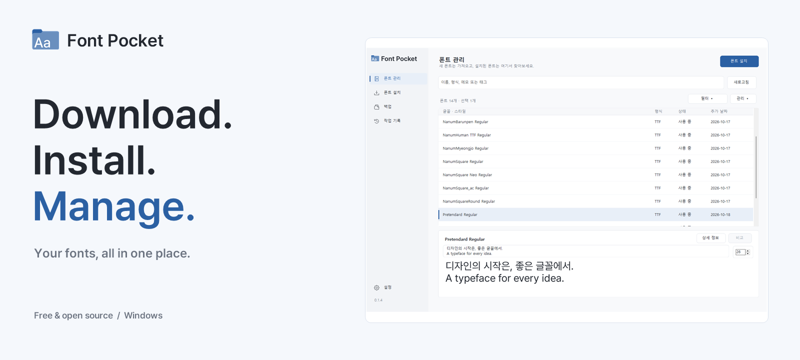
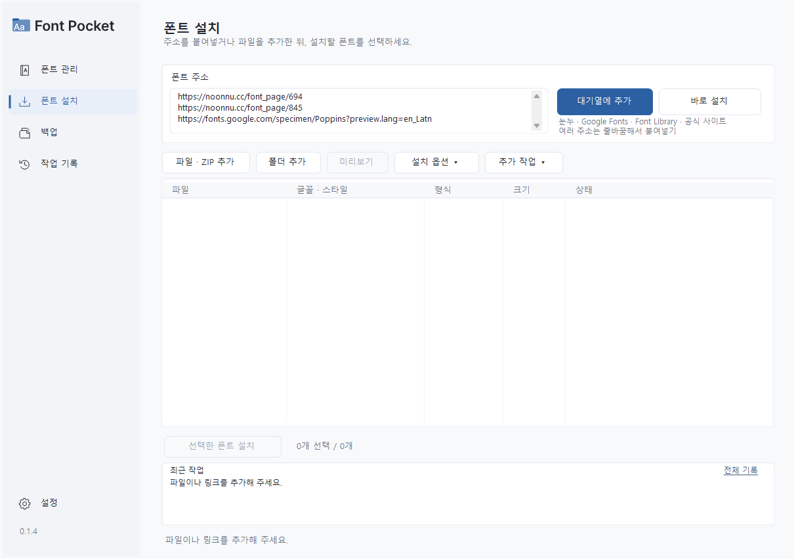
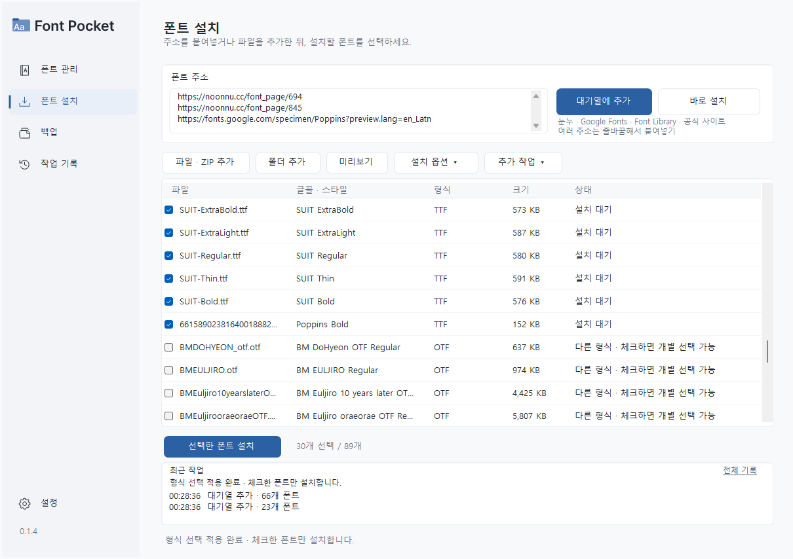
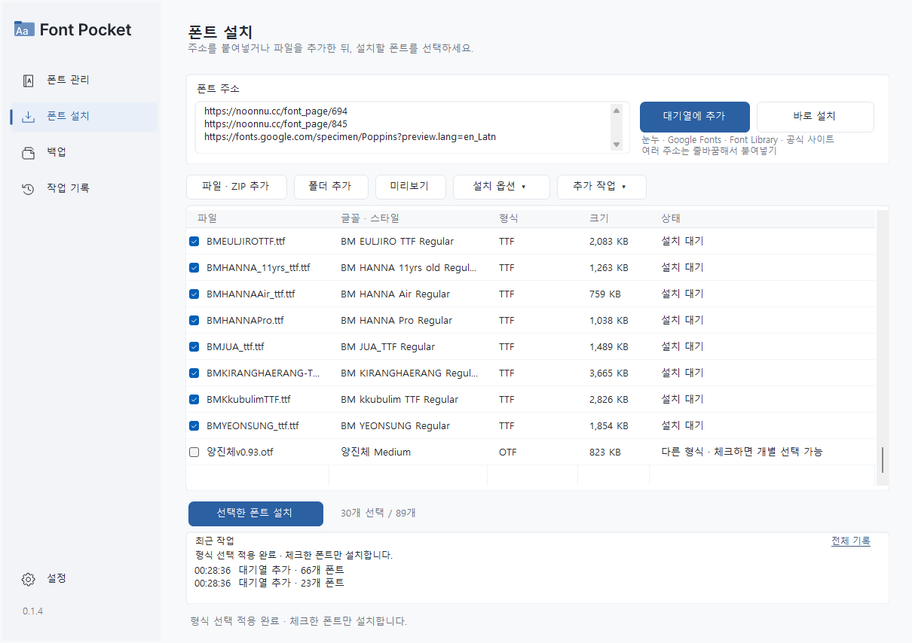
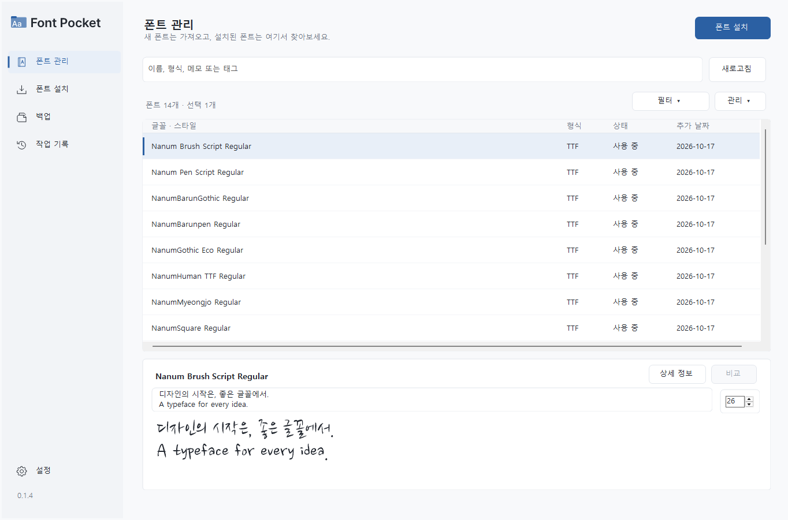
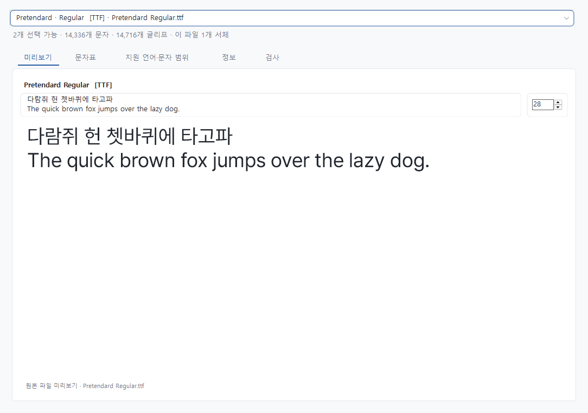
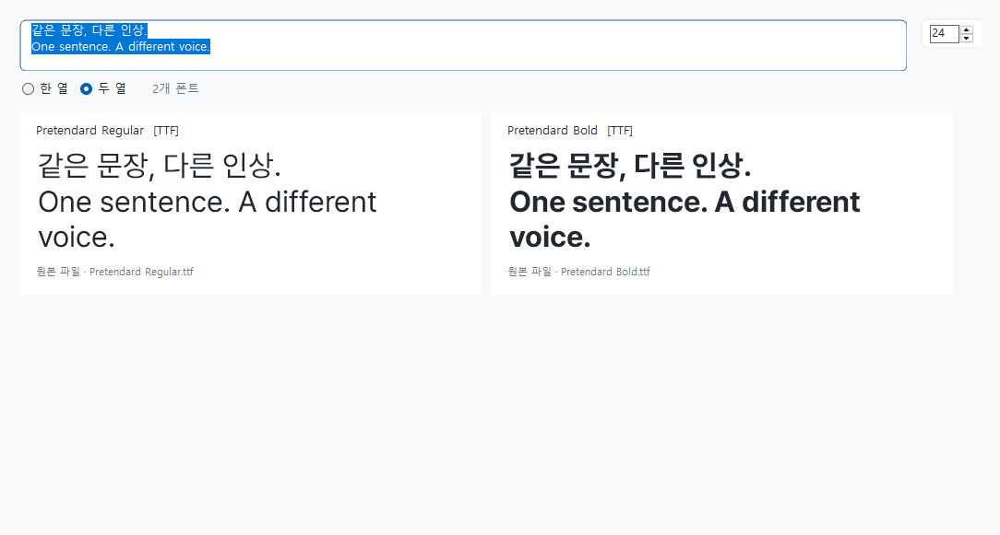

<p align="center"><a href="README.md">English</a> · <strong>한국어</strong></p>

<p align="center">
  
</p>

<p align="center">
  <strong>링크로 여러 폰트를 한 번에 다운로드하고, 설치부터 관리까지.</strong><br>
  여러 사이트의 링크를 붙여넣어 폰트를 일괄 다운로드·설치하고, 미리보기·정리·백업까지 한곳에서 처리하는 Windows용 무료 오픈소스 도구입니다. ZIP과 폴더도 함께 가져올 수 있습니다.
</p>

<p align="center">
  <a href="https://github.com/tae0604/font-pocket/releases/latest"><strong>다운로드</strong></a> ·
  <a href="#사용-방법">사용 방법</a> ·
  <a href="#만들게-된-계기">만들게 된 계기</a> ·
  <a href="https://github.com/tae0604/font-pocket/issues">문제·제안</a> ·
  <a href="README.md">English</a>
</p>

<p align="center">
  <a href="https://github.com/tae0604/font-pocket/actions/workflows/windows-build.yml"></a>
  <a href="https://github.com/tae0604/font-pocket/releases/latest"></a>
  <a href="https://github.com/tae0604/font-pocket/releases"></a>
  
  <a href="LICENSE"></a>
</p>

| 모아서 설치 | 설치 전에 확인 | 정리하고 백업 |
| --- | --- | --- |
| 눈누·Google Fonts·공식 사이트의 링크, ZIP과 폴더에서 필요한 폰트를 같은 대기열로 모읍니다. | 문구와 크기를 바꿔 미리 보고, 여러 폰트와 가변 축의 차이를 확인합니다. | 설치된 폰트를 검색하고, 사용 설정·중복 확인·백업과 복원까지 한곳에서 처리합니다. |

## 화면으로 보기

### 링크로 여러 폰트 다운로드

폰트 주소를 한 줄에 하나씩 붙여넣고 **대기열에 추가**를 누른 뒤, 다운로드할 파일을 선택하세요.



<details>
<summary>다운로드한 폰트·ZIP·개별 폰트를 같은 대기열에 모으기</summary>

다운로드한 폰트에서 필요한 스타일을 고를 수 있습니다. 프리텐다드·SUIT·Poppins를 사용한 예시입니다.



**파일 / ZIP 추가**로 `BM-fonts-package.zip` 같은 묶음 파일이나 `양진체v0.93.otf` 같은 개별 파일도 같은 대기열에 넣을 수 있습니다. ZIP은 앱에서 풀어 주며, 설치 전에 원하는 파일 형식을 선택할 수 있습니다.



예제 링크:

```text
https://noonnu.cc/font_page/694
https://noonnu.cc/font_page/845
https://fonts.google.com/specimen/Poppins?preview.lang=en_Latn
```

</details>

### 설치된 폰트 관리

**설치된 폰트는 목록에서 찾고, 선택한 글꼴은 바로 미리 봅니다.**



<details>
<summary>상세 정보와 폰트 비교 화면 보기</summary>

### 문구와 크기를 바로 바꾸는 미리보기

문자표, 지원 문자 범위, 제작자 정보와 파일 검사도 같은 창에서 확인합니다.



### 같은 문장으로 폰트 비교



</details>

## 다운로드

**[최신 설치 파일 받기 →](https://github.com/tae0604/font-pocket/releases/latest)**

릴리스에서 **`FontPocket-Setup-<버전>.exe`**를 받아 실행하세요. 현재 Windows 계정에 설치되며 기존 폰트와 개인 설정은 유지됩니다.

- Windows 10 / 11 · .NET Framework 4.8 이상
- 한국어·영어 지원 — **설정 → 언어**에서 변경 후 재실행
- 앱 내 가변 미리보기와 WOFF2 가져오기에는 Microsoft Edge WebView2 Runtime 필요

<details>
<summary>설치·업데이트 안내</summary>

- `.exe.sha256`은 설치 파일의 무결성을 확인하는 용도입니다. 일반 사용자는 설치 파일만 받아도 됩니다.
- 현재 설치 파일은 코드 서명되지 않았습니다. 자세한 내용은 [서명 정책](CODE_SIGNING.md)을 참고하세요.
- **설정 → 업데이트 확인**에서 새 버전을 확인할 수 있습니다. 시작할 때 하루 한 번 자동 확인하도록 설정할 수도 있습니다.
- 앱은 이 공식 저장소의 정식 릴리스에서만 업데이트를 받으며 설치 파일의 크기와 SHA-256을 확인합니다.

</details>

## 사용 방법

1. **폰트 설치**에서 사이트 주소를 붙여넣거나 폰트 파일·ZIP·폴더를 추가합니다.
2. 미리보기를 확인하고, 설치할 파일의 체크박스를 선택한 뒤 **선택한 폰트 설치**를 누릅니다.
3. **폰트 관리**에서 검색·비교·사용 설정을 하고, 필요한 폰트는 **백업**에 보관합니다.

Windows에서 폰트 파일을 Font Pocket으로 열 수도 있습니다. 여러 파일을 열면 하나의 미리보기 창에서 선택할 수 있으며, 설치는 직접 버튼을 눌러 진행합니다.

## 주요 기능

| 기능 | 할 수 있는 일 |
| --- | --- |
| 가져오기 | 눈누·Google Fonts·Font Library·공식 사이트 링크, 직접 다운로드 주소, ZIP, 파일과 폴더 |
| 파일 형식 | TTF·OTF·TTC·OTC·SFNT·WOFF·WOFF2 가져오기. WOFF·WOFF2는 Windows 설치용 형식으로 변환 |
| 미리보기·비교 | 문구·크기 바로 조절, 여러 폰트 비교, 전체 견본, 앱 내 가변 축 조절 |
| 검색·필터 | 굵기, 언어·문자 범위, 가변/정적, 형식 필터와 추가 날짜 |
| 폰트 관리 | 활성화·비활성화, 중복 확인, 즐겨찾기, 메모·태그·모음, 버전 관리 |
| 상세 정보 | 문자표, 지원 문자 범위, 제작자·라이선스 정보, 파일 검사 |
| 백업·복원 | 선택한 폰트 및 환경 백업, 취소 시 기존 ZIP 보존, 삭제 전 복구용 백업 |
| 인쇄 | 폰트 견본·문자표 인쇄 및 PDF 저장 |

## 만들게 된 계기

안녕하세요! 저는 코딩과 디자인에 관심이 많은 중학생입니다.

평소에는 맥을 사용하지만, 가끔 윈도우를 초기화하거나 컴퓨터를 새로 살 때마다 피그마(Figma)에서 쓸 폰트를 다시 준비해야 했습니다. 폰트를 하나씩 다운로드하고, 압축을 풀고, 폴더 안에서 필요한 파일을 찾아 설치하는 과정을 매번 반복했습니다.

이 과정이 번거로워서 **필요한 폰트를 한 번에 다운로드하고 설치할 수 있으면 좋겠다**는 생각으로 Font Pocket을 만들기 시작했습니다. 지금은 설치뿐 아니라 미리보기, 비교, 정리와 백업도 함께 할 수 있는 폰트 관리 도구로 다듬고 있습니다.

## 피드백·개발

직접 사용하면서 개선하고 있습니다. 불편한 점이나 필요한 기능은 [Issues](https://github.com/tae0604/font-pocket/issues)에 남겨 주세요.

[빌드 방법](BUILDING.md) · [개인정보 안내](PRIVACY.md) · [서명 정책](CODE_SIGNING.md) · [0.1.4 변경 사항](CHANGELOG-0.1.4.md)

프로젝트의 원본 코드와 직접 제작한 자산은 [MIT 라이선스](LICENSE)를 따릅니다. 포함된 폰트와 외부 구성 요소에는 각각의 라이선스가 적용됩니다. [외부 구성 요소 안내](THIRD_PARTY_NOTICES.md)를 확인하세요. 다운로드하는 폰트의 사용 조건은 해당 제작자의 라이선스를 확인해 주세요.
