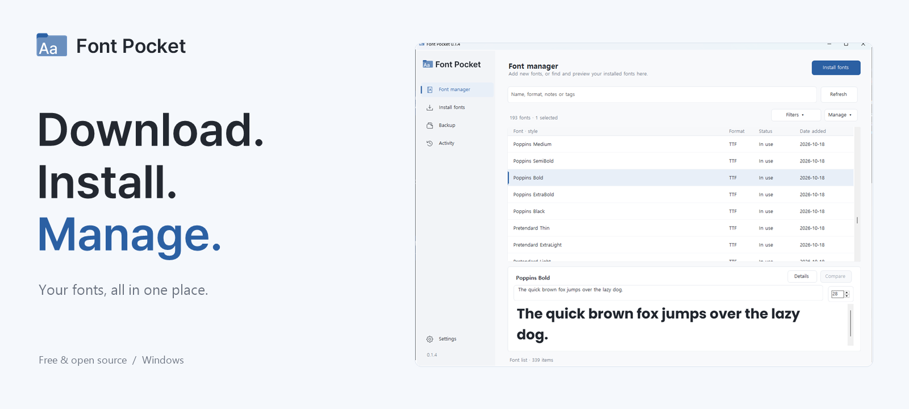
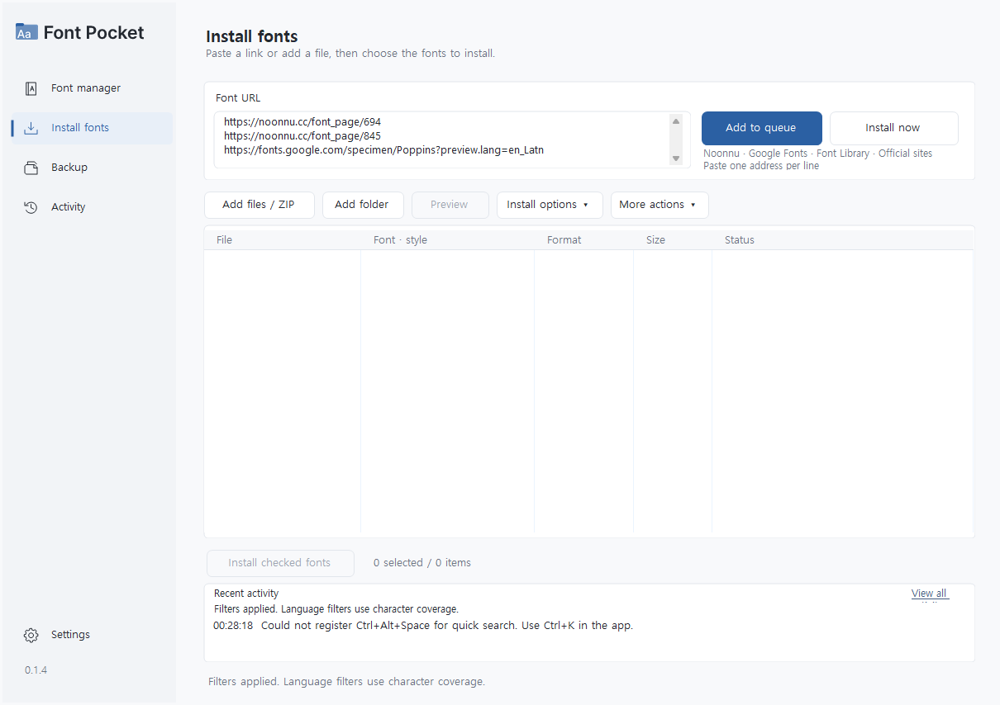
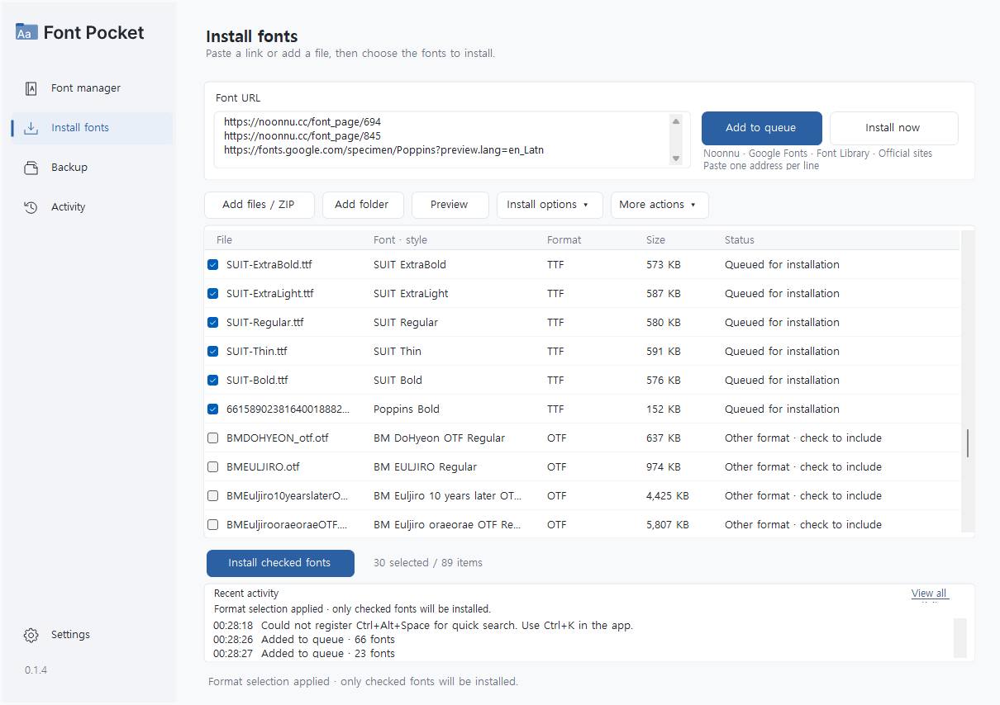
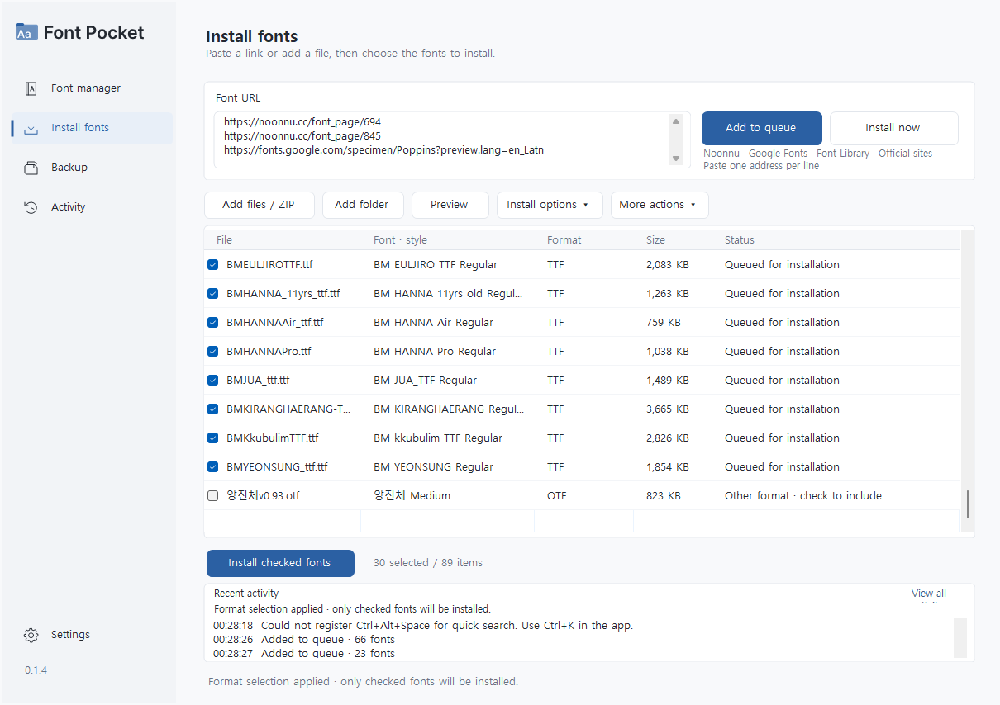
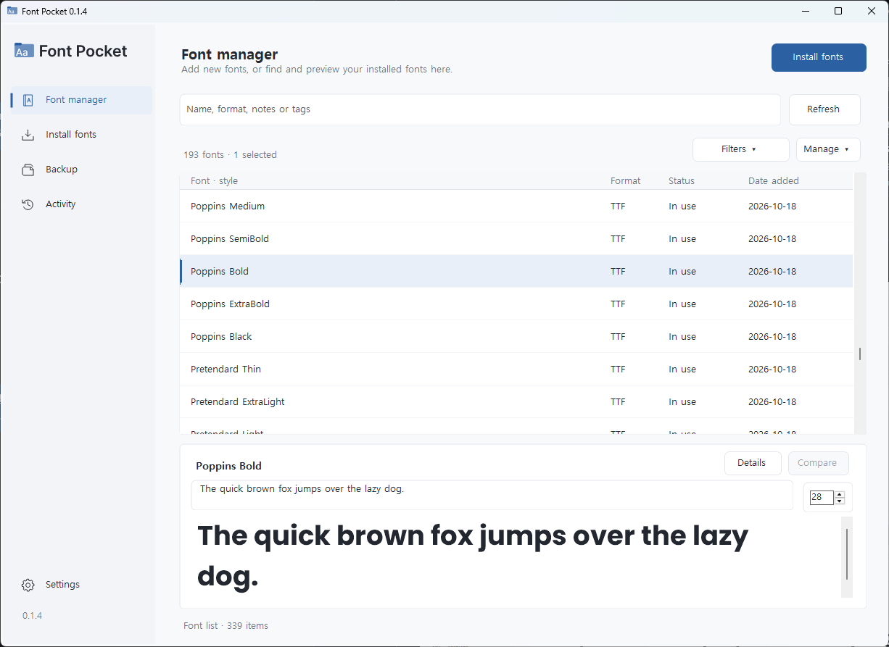
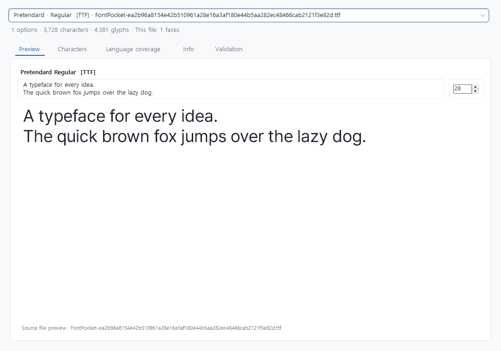
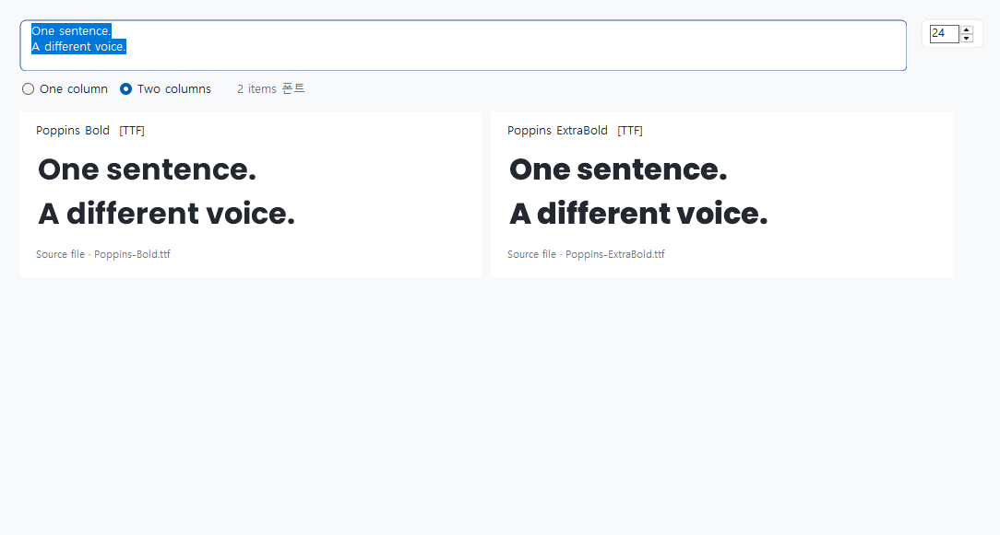

<p align="center"><strong>English</strong> · <a href="README.ko.md">한국어</a></p>

<p align="center">
  
</p>

<p align="center">
  <strong>Batch-download fonts from links. Install and manage them in one place.</strong><br>
  A free, open-source Windows font tool built by a middle school student.
</p>

<p align="center">
  <a href="https://github.com/tae0604/font-pocket/releases/latest"><strong>Download</strong></a> ·
  <a href="#getting-started">Getting started</a> ·
  <a href="#why-i-built-it">Why I built it</a> ·
  <a href="https://github.com/tae0604/font-pocket/issues">Feedback</a> ·
  <a href="BUILDING.md">Build from source</a>
</p>

<p align="center">
  <a href="https://github.com/tae0604/font-pocket/actions/workflows/windows-build.yml"></a>
  <a href="https://github.com/tae0604/font-pocket/releases/latest"></a>
  <a href="https://github.com/tae0604/font-pocket/releases"></a>
  
  <a href="LICENSE"></a>
</p>

| Paste links. Get fonts. | Preview before installing. | Keep your fonts organized. |
| --- | --- | --- |
| Add multiple font links and download them together. ZIP archives, font files and folders can share the same queue. | Try your own text, compare typefaces and adjust variable-font axes inside the app. | Search installed fonts, check duplicates, enable or disable fonts, and back up what you need. |

## See it in action

### Download several fonts from links

Paste one font URL per line, choose **Add to queue**, then pick the files to download.



<details>
<summary>Downloaded fonts, ZIP archives and individual font files in one queue</summary>

Choose the styles you need after downloading. This example uses Pretendard, SUIT and Poppins.



Use **Add files / ZIP** to add a package such as `BM-fonts-package.zip` or a single file such as `양진체v0.93.otf` to the same queue. ZIP archives are extracted by the app; you can choose the font format before installing.



Try these links:

```text
https://noonnu.cc/font_page/694
https://noonnu.cc/font_page/845
https://fonts.google.com/specimen/Poppins?preview.lang=en_Latn
```

</details>

### Manage installed fonts

**Find installed fonts and preview your selection right below the list.**



<details>
<summary>Font details and comparison screenshots</summary>

### Edit preview text and size directly

Explore character maps, character coverage, metadata and file inspection in the same window.



### Compare fonts with the same text



</details>

## Download

**[Get the latest installer →](https://github.com/tae0604/font-pocket/releases/latest)**

Download **`FontPocket-Setup-<version>.exe`** from the release assets and run it. Font Pocket installs for the current Windows account. Existing fonts and personal settings are preserved when updating.

- Windows 10 / 11 and .NET Framework 4.8 or later
- Korean and English — change the language in **Settings → Language**, then restart
- Microsoft Edge WebView2 Runtime is needed for in-app variable previews and WOFF2 imports

<details>
<summary>Installation and updates</summary>

- The `.exe.sha256` file is provided for integrity verification. You only need the installer for a normal installation.
- Current installers are unsigned. See the [code signing policy](CODE_SIGNING.md).
- Use **Settings → Check for updates** to check manually, or enable a daily check at startup.
- App updates come only from this official repository. Font Pocket verifies the installer size and SHA-256 before installation.

</details>

## Getting started

1. Open **Install fonts** and paste one or more font links. You can also add font files, ZIP archives or folders.
2. Preview the available fonts, check the files you want and choose **Install selected fonts**.
3. Open **Font manager** to search, compare and organize installed fonts, or **Backup** to save a copy.

You can also open font files directly with Font Pocket in Windows. Multiple files share one preview window; installation starts when you choose to install.

## Features

| Area | What you can do |
| --- | --- |
| Batch downloads and imports | Gather fonts from Noonnu, Google Fonts, Font Library, official websites, direct download links, ZIP archives and folders |
| File formats | Import TTF, OTF, TTC, OTC, SFNT, WOFF and WOFF2. WOFF/WOFF2 files are converted to installable TTF/OTF |
| Preview and compare | Edit sample text and size, compare fonts, browse a catalog and adjust variable-font axes in the app |
| Search and filters | Filter by weight, language/script coverage, variable/static type and format; view dates added |
| Font management | Enable or disable fonts, check duplicates, organize favorites and collections, add notes and tags, and manage versions |
| Inspection | Explore characters, coverage, creator and license metadata, and inspect font files |
| Backup and restore | Back up selected fonts or your environment; preserve an existing ZIP when cancelling; create recovery backups before deletion |
| Printing | Print font samples and character maps, or save them as PDF |

## Why I built it

Hi! I'm a middle school student interested in coding and design.

I normally use a Mac, but whenever I reset Windows or got a new computer, I had to prepare my fonts for Figma again: download each font, extract the ZIP files, open the folders and install the font files one by one.

Repeating those steps was tedious. I started Font Pocket so I could **paste multiple links, download the fonts together and install them in one go**. Font management grew from there: previewing, comparing, organizing and backing up fonts in the same app.

I'm improving it as I use it. If something gets in your way or you have an idea, please [open an issue](https://github.com/tae0604/font-pocket/issues).

## Development and license

[Build instructions](BUILDING.md) · [Privacy](PRIVACY.md) · [Code signing](CODE_SIGNING.md) · [0.1.4 changes](CHANGELOG-0.1.4.md)

The original project code and artwork are available under the [MIT license](LICENSE). Bundled fonts and external components retain their own licenses; see [third-party notices](THIRD_PARTY_NOTICES.md). Fonts you download remain subject to their creators' licenses.
